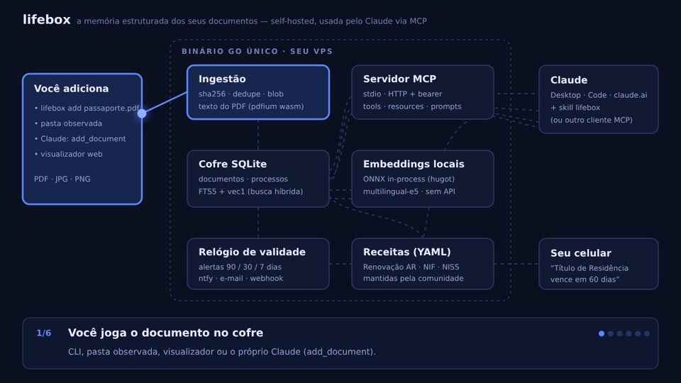

# lifebox

**Your life documents, organized by Claude, in the storage you already use.**



lifebox is an open-source skill for [Claude](https://claude.ai). It turns a folder in your Google
Drive (or Notion, OneDrive, Dropbox, Box, or a folder on your computer) into an organized vault of
passports, ID cards, licences, insurance policies, leases and other paperwork, and keeps track of
what expires and what you need next.

There is no lifebox server, database or API key. Claude does the work through the connectors you
already use, and everything stays in your own storage as ordinary files.

## What it does

- **Files your documents.** Drop scans or PDFs into `Lifebox/Inbox`. Claude reads them, renames
  them like `2027-03-12 · Driver's License · Alex.pdf`, records the type, holder and dates, and
  files them in `Lifebox/Documents`.
- **Knows what expires.** Each lifebox conversation starts with a short list of what is expired or
  due in the next 90 days.
- **Answers questions.** "When does my passport expire?" "Send me the link to my lease."
- **Plans paperwork.** "Make me a schedule to renew my driver's license" gives you a dated
  checklist of steps and documents, checked against official sources for where you live, and
  saved in your vault.
- **Reminds you.** Calendar events before things expire, through your calendar connector or an
  `.ics` file you import once.
- **Shows an overview.** A dashboard of everything in the vault.

## How it works

```
Your storage: Google Drive · Notion · OneDrive · Dropbox · Box · a local folder
  Lifebox/Inbox · Documents · Archive · Plans
        ⇅  Claude's connectors (or local files)
Claude + the lifebox skill  ──→  your calendar (connector or .ics)
```

| Part | What it is |
|---|---|
| [`skills/lifebox/SKILL.md`](skills/lifebox/SKILL.md) | The workflows Claude follows |
| [`skills/lifebox/references/`](skills/lifebox/references) | Vault format, how to read documents, storage adapters, reminder rules, process recipes, dashboard |
| [`skills/lifebox/scripts/lifebox.py`](skills/lifebox/scripts/lifebox.py) | Deterministic helpers: file names, records, dates, calendar files, passport MRZ. Python standard library only |

## Install

**Claude.ai and Claude Desktop.** Add the plugin from this repository in Claude's Customize menu,
or download `lifebox-skill.zip` from the [latest release](https://github.com/rickmff/lifebox/releases)
and upload it as a skill. Skills need code execution turned on in your settings.

**Claude Code.**

```bash
claude plugin install lifebox --marketplace rickmff/lifebox
```

Then turn on the connector for where your documents live (Settings → Connectors), or open a folder
in Claude Code or Cowork. Step-by-step instructions are in [docs/install.md](docs/install.md).

## Storage

| Storage | Status | How records are kept |
|---|---|---|
| Google Drive | Verified | File description |
| Local folder (Claude Code, Cowork) | Verified | `.lifebox.md` file next to each document |
| Notion | To verify | Database properties |
| OneDrive / SharePoint | Experimental | `.lifebox.md` files, or linked documents if the connector is read-only |
| Dropbox | Experimental | `.lifebox.md` files, or linked documents |
| Box | Experimental | File description or `.lifebox.md` files |

Documents can also stay where they are (another drive, an email, a web portal) and be listed in
the vault as linked documents. See [docs/adapters.md](docs/adapters.md).

## Try it

- "Set up lifebox in my Google Drive."
- "Process my lifebox inbox."
- "When does my passport expire?"
- "Make me a schedule to renew my driver's license."
- "Add calendar reminders for everything that expires this year."
- "Show me my vault."

## Recipes

Generic, country-independent templates for common paperwork. Claude adapts each one to your
country with official sources before planning.

| Recipe | For |
|---|---|
| `renew-passport-or-id` | Passports and ID cards |
| `renew-driver-license` | Driving licences |
| `vehicle-inspection` | Periodic vehicle inspections |
| `insurance-renewal` | Car, home, health and other policies |
| `rental-application` | Applying for a rental home |
| `lease-end` | Ending or renewing a lease |
| `moving-house` | Moving and updating your address |

New recipes are welcome: see [docs/recipes.md](docs/recipes.md).

## Privacy

Your files stay in your storage. Claude reads them inside your own conversations, through the
connectors you turned on, and lifebox sends nothing anywhere else. Records keep only the last four
characters of document numbers. Details in [docs/privacy.md](docs/privacy.md).

Process guidance is general information, not legal advice. Always check the official source.

## Development

```bash
python3 -m unittest discover -s tests
claude plugin validate .
```

See [CONTRIBUTING.md](CONTRIBUTING.md).

## License

[Apache-2.0](LICENSE)
