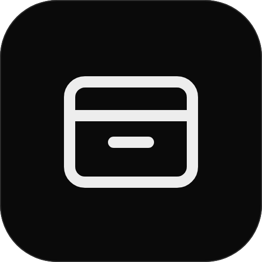
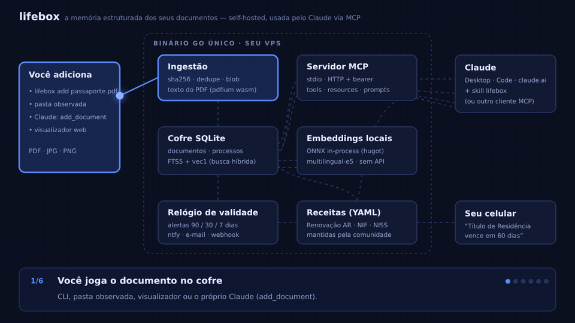

  

<h1 align="center">lifebox</h1>

  Your life documents, organized by Claude — in the storage you already use.

  
  

lifebox is an open-source skill for [Claude](https://claude.ai) that turns a folder in Google
Drive, Notion, OneDrive, Dropbox, Box or on your computer into an organized vault for passports,
IDs, licenses, insurance policies, leases and other paperwork. There is no server, database or API
key: Claude works through the connectors you already use, and your files stay where they are.

## Features

- **Inbox filing**: drop scans into `Lifebox/Inbox`; Claude reads, renames
  (`2027-03-12 · Passport · Alex.pdf`) and files them with structured metadata.
- **Expiry radar**: every session starts with what is expired or due in the next 90 days.
- **Dated plans**: ask for a schedule to renew a license or move house; Claude builds a dated
  checklist and confirms the local rules with official sources.
- **Reminders**: calendar events through your calendar connector, or an `.ics` file to import.
- **Dashboard**: a visual overview of every document and plan.

## Quick start

1. **Install the skill.**
   - Claude Code: `claude plugin install lifebox --marketplace rickmff/lifebox`
   - Claude.ai and Claude Desktop: add this repository as a plugin, or zip the `skills/lifebox`
     folder and upload it as a skill. Code execution must be turned on.
2. **Connect your storage** in Settings → Connectors, or open a local folder in Claude Code or
   Cowork.
3. **Ask Claude:** "Set up lifebox in my Google Drive."

See the [installation guide](docs/install.md) for details.

## Supported storage

| Storage | Status |
|---|---|
| Google Drive, local folder | Verified |
| Notion | To verify |
| OneDrive / SharePoint, Dropbox, Box | Experimental |

Details in [docs/adapters.md](docs/adapters.md).

## Documentation

[Installation](docs/install.md) · [Storage adapters](docs/adapters.md) ·
[Recipes](docs/recipes.md) · [Privacy](docs/privacy.md) ·
[Skill instructions](skills/lifebox/SKILL.md) · [Vault spec](skills/lifebox/references/vault-spec.md)

## Contributing

Recipes, storage adapters and fixes are welcome. Read [CONTRIBUTING.md](CONTRIBUTING.md) and run
the tests with `python3 -m unittest discover -s tests`.

## License

[Apache-2.0](LICENSE). Process guidance is general information, not legal advice.
